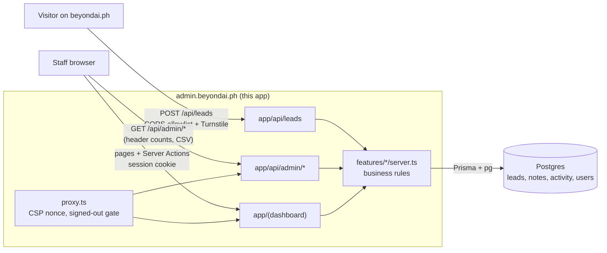

# Architecture

One Next.js application serves the public enquiry endpoint, the admin API, and the staff dashboard. The public website is a separate application. The two talk only through `POST /api/leads`.

## Layers and import rules

Code lives in three layers. Imports flow downward only, and ESLint (`eslint.config.mjs`) fails the build when a rule is broken.

- **app/** holds thin route files. Pages, route handlers, and layouts parse input, check the session, and call feature functions.
- **features/** each own their schemas, server functions, Server Actions, components, and tests. Other code imports a feature through `index.ts` (client-safe: components, labels, types) or `server.ts` (server-only: data access and business rules, guarded by `import 'server-only'`).
- **shared/** holds code with no knowledge of any feature: UI components, pure helpers, and server infrastructure in `shared/server/` (Prisma client, logger, CORS, Turnstile, rate limiting, HTTP helpers).
- **config/** validates environment variables.

## Business rules live in one place

Route handlers and Server Actions are both thin wrappers around the same functions in `features/*/server/`. Each function returns a `Result` (`shared/lib/result.ts`) instead of throwing for expected cases such as "not found" or "deleted". Route handlers map that to an HTTP status, and Server Actions map it to form state.

- `createLead` saves the enquiry with `replyDueAt = createdAt + 24h` and logs `created`.
- `updateLead` locks the row (`SELECT … FOR UPDATE`), applies the status and owner rules, and writes one activity row per change in the same transaction. Moving to Contacted sets `firstContactedAt` once. Moving to Won or Lost needs a reason, which is saved as a note. Deleted leads are read-only.
- `listLeads` puts overdue enquiries first. Prisma cannot sort by a computed condition, so it counts and fetches the overdue and remaining groups separately and stitches each page together. Search escapes LIKE wildcards.
- Overdue means past `replyDueAt`, no `firstContactedAt`, and still New or Contacted (`features/leads/deadlines.ts`).

## Rendering and data

- Pages are Server Components that read through the feature server functions. Writes from the dashboard go through Server Actions. Filters, sorting, and pagination are URL parameters on a plain GET form, so every view is a shareable link and works without JavaScript.
- The only client-side fetching is the header's New and overdue counts, which TanStack Query refreshes from `GET /api/admin/overview?scope=header` every minute.
- Browser code never imports classic `zod`. Server schemas live in `schema.ts` files, labels in `options.ts`, and browser-side response schemas use `zod/mini`.
- All times are stored in UTC and shown in Manila time (`shared/lib/manila-time.ts`). The preferred call time also shows the viewer's local time when their clock differs.

## Security

- **Public endpoint** (`features/leads/server/submit-enquiry.ts`): origin allowlist first, then a 16 KB body limit, per-IP rate limits (5 per 10 minutes, 20 per day, keyed by an HMAC of the IP), the honeypot (fake success, nothing saved), strict Zod validation, Turnstile, then the database. Validation runs before Turnstile so a typo does not burn the visitor's single-use token.
- **Authentication**: Auth.js with email sign-in links and database sessions (12 hours). Access is invite-only. The `signIn` callback refuses unknown and inactive emails, the adapter's `createUser` is disabled, and the login form gives the same answer for every email. Deactivating a user deletes their sessions.
- **Authorization**: `proxy.ts` turns away requests without a session cookie (redirect for pages, 401 for `/api/admin/*`). That check is only optimistic. Every page calls `requireUser()` or `requireAdmin()`, and every admin route handler calls `authorizeApi()`, which validates the session against the database, checks the role, and rejects state-changing requests whose `Origin` is not this app.
- **Admin-only pages** answer staff with the not-found page. They render inside the dashboard's loading boundary, so the HTTP status is already 200 when the check runs, but no admin data is sent.
- **Headers**: `proxy.ts` sets a nonce-based CSP with `frame-ancestors 'none'`, and `next.config.ts` adds HSTS, `nosniff`, `X-Frame-Options: DENY`, and `Referrer-Policy`. Inline `style` attributes are blocked, so charts use SVG attributes instead.
- **Data**: lead text is rendered as plain text only. CSV exports neutralize spreadsheet formulas. A database trigger rejects every UPDATE on `LeadActivity`.
- **Logging**: `shared/server/logger.ts` writes JSON lines and redacts names, emails, messages, tokens, and IPs by key, and masks emails and phone numbers inside any other string.

## Privacy

- Consent is required, and each lead stores `consentAt` and the `consentVersion` the visitor saw. A version that differs from `CONSENT_NOTICE_VERSION` is kept and logged as a warning, so a cached public page never loses an enquiry.
- No IP address is stored. Rate-limit keys are keyed hashes that expire with their window.
- Admins can export everything stored for an email as JSON, or erase it permanently, from Settings → Privacy. The email travels in a POST body, never a URL. `PrivacyLog` records each request with a count and the acting admin, never the personal data.
- The retention job (`/api/cron/retention`, daily) deletes soft-deleted leads after 30 days and Won or Lost leads two years after their last update. Both periods are placeholders in `features/privacy/server/privacy.ts` until the business confirms them.

## Testing

| Layer         | Tool                           | Location                       |
| ------------- | ------------------------------ | ------------------------------ |
| Unit          | Vitest                         | next to the code, `*.test.ts`  |
| Component     | Vitest and Testing Library     | next to the code, `*.test.tsx` |
| API           | Vitest against a real Postgres | `tests/api/`                   |
| HTTP mocking  | MSW (Turnstile, fetch)         | `tests/fixtures/`              |
| End-to-end    | Playwright, three browsers     | `tests/e2e/`                   |
| Accessibility | axe in Playwright, Storybook   | `tests/e2e/fixtures.ts`        |
| Performance   | Lighthouse CI (login page)     | `lighthouserc.json`            |

API tests replace only Auth.js's `auth()` with a controllable session. The active-user check, role checks, origin check, validation, and every query run for real. Unit tests fail on any network request that is not mocked.

## Performance budgets

Lighthouse CI checks `/login`, the only page reachable without a session, against LCP 2.5 s, CLS 0.1, Total Blocking Time 200 ms, and 190 KB of compressed JavaScript. Dashboard pages were measured at about 178 KB of compressed JavaScript. Keep new client components small: tables, filters, and pagination render on the server for this reason.
